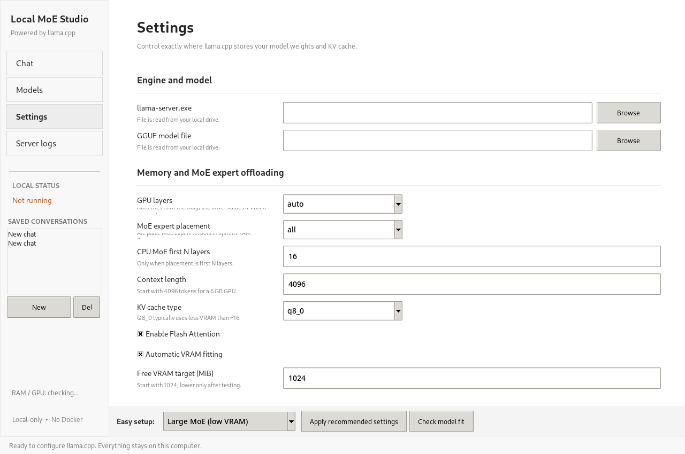

# Local MoE Studio

**A beginner-friendly Windows desktop GUI for running GGUF language models with llama.cpp, including MoE expert offloading to system RAM.**

> **Status: v0.5.1 alpha / developer preview.** Source and unit tests are available. It has **not** completed Windows CUDA hardware validation or public-distribution security testing.

## Features

- One-click installation/update of official llama.cpp Windows releases (CUDA or CPU mode).
- Browse Hugging Face GGUF repositories and download a selected **single-file** quantization.
- Beginner presets: Fast, Balanced, Large MoE (low VRAM), CPU only.
- Advanced MoE CPU expert placement, GPU layers, context length, Flash Attention, KV cache controls.
- Local streaming chat and saved conversations.
- NVIDIA memory/status information and server log window.
- Python standard-library runtime for source use; **no Docker**.

## Screenshots



## Installer fix (v0.5.1)

The one-click installer now detects official llama.cpp Windows packages from upstream GitHub **pre-release** builds (such as `b11580`). It also recognizes both historical and current CUDA runtime ZIP filenames and pairs the exact CUDA versions. v0.5.0 incorrectly skipped these builds, producing `No matching official Windows archive found`.

**To update:** Close Local MoE Studio, replace the app files with the latest GitHub source, and restart via `START_WINDOWS.bat`. Your GGUF models and chat history are stored in the Windows per-user application-data folder and should remain intact. Retry **Models → Install / Update llama.cpp**, selecting `cuda12`.

This is a selector/test fix; the full CUDA download and NVIDIA inference still require on-device validation.

## Quick start (Windows)

1. Install Python 3.11 or 3.12.
2. Click **Code → Download ZIP** on GitHub; extract the repository.
3. Double-click `START_WINDOWS.bat`.
4. In **Models**, click **Install / Update llama.cpp**.
5. Select a Hugging Face GGUF repository and download a quantized model.
6. Apply the **Large MoE (low VRAM)** preset for compatible MoE models and click **Start model**.

Full instructions: [Windows installation](docs/INSTALL_WINDOWS.md).

## Alternative developer install

```powershell
py -3 -m pip install -e .
py -3 -m localmoestudio
```

## Repository structure

```text
local-moe-studio/
├── src/localmoestudio/       # Windows GUI, backend, downloads, installer
├── tests/                    # Automated unit tests
├── docs/                     # Install, architecture, audit, release criteria
├── scripts/                  # Build/test scripts for Windows
├── .github/workflows/        # Cross-platform unit-test CI
├── pyproject.toml            # Python packaging metadata
├── START_WINDOWS.bat         # Source launcher
├── LICENSE                   # MIT (original application code)
└── README.md
```

## Supported platform and constraints

- Primarily Windows 10/11. NVIDIA CUDA support requires a compatible NVIDIA driver and correct upstream llama.cpp build.
- Model size on disk is **not** total inference RAM consumption. Large MoE models require free system RAM and may be slow with CPU expert offloading.
- The current model downloader does **not** automatically retrieve multipart GGUF shards.
- Existing Ollama installations may remain installed, but avoid loading large models in both at once.
- llama.cpp itself, upstream CUDA DLLs and GGUF models are downloaded separately and have their **own** license terms.

## Privacy

Chat history and preferences are kept on the device in the current user's application-data folder (unencrypted local files). Model metadata/engine downloads contact GitHub and Hugging Face only when requested. The app does not add analytics/telemetry.

## Tests and builds

```powershell
py -3 -m unittest discover -s tests -v
```

On Windows, `scripts\build_windows.bat` creates an **unsigned developer EXE** with PyInstaller. This is not a one-click installer suitable for public release.

## Roadmap

- [ ] Fully bundled and signed Windows installer
- [ ] Verified automatic MoE benchmarking and memory advisor
- [ ] Split GGUF shard management and cryptographic download verification
- [ ] Model licenses and compatibility information in the browser
- [ ] Tested inference builds across 4–12 GB NVIDIA VRAM
- [ ] Optional local RAG/document chat

## Documents

[Architecture](docs/ARCHITECTURE.md) · [Product audit](docs/PRODUCT_AUDIT.md) · [Release checklist](docs/RELEASE_CHECKLIST.md) · [Contributing](docs/CONTRIBUTING.md) · [Security](SECURITY.md)

## Licensing

Original Local MoE Studio application code in this repository is offered under the [MIT License](LICENSE). Redistribution of llama.cpp, drivers/runtime libraries, or model weights is governed by their separate license obligations.
